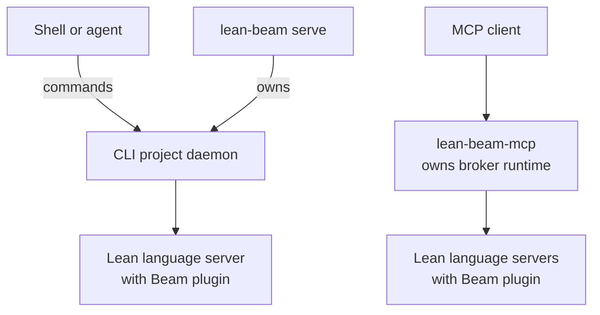

# Lean Beam

Lean Beam gives AI agents and other tools an efficient way to interact with Lean in an existing
project. Its central operation, [`runAt`](docs/STATUS.md#core-lean-surface), tries a Lean command or
tactic at a position in a saved file without changing the source. Each attempt starts from the
selected Lean context, so agents can explore alternatives independently and run independent
checks concurrently.

Beam exposes these operations through a [`lean-beam` CLI](docs/SETUP.md#use-beam-from-a-lean-project)
and an [MCP server](docs/SETUP.md#mcp-setup). Keeping the module context available supports repeated
proof-development experiments without creating a scratch file for each attempt or repeatedly
building the project.

We have found Beam useful for proof repair, proof search experiments, proof translation and porting,
autoformalization experiments, and regular AI-assisted Lean editing.

Beam is beta software, and its interfaces may change. See [Status](docs/STATUS.md) for current
capabilities and limitations, and [Compatibility](docs/COMPATIBILITY.md) for supported toolchains
and clients.

## Install and connect your agent

You do not add Beam to your project's lakefile or install it separately in each project. Choose
the installation path that matches your Lean setup:

- **A Lean toolchain that includes Beam:** follow [bundled Beam setup](docs/SETUP.md#use-beam-bundled-with-lean).
  Register that toolchain's `lean-beam-mcp` with your agent client. Each bundled server serves
  projects using its containing Lean installation; an ordinary elan toolchain need not include Beam.
- **A standalone installation:** on Linux or macOS, run `./scripts/install-beam.sh` from a Beam
  checkout with `elan` on `PATH`. The installer offers toolchains, agent skills, and MCP client
  registration. Windows x86_64 uses the bundled toolchain path.

A skill gives an agent instructions for using the CLI; MCP registration lets a client call Beam's
structured tools. Choose the integration your client supports. For a standalone install, examples
for three clients are shown below; run the one matching your client:

```bash
./scripts/install-beam.sh --codex --codex-mcp
./scripts/install-beam.sh --claude --claude-mcp
./scripts/install-beam.sh --pi
```

The standalone installer puts commands in `~/.local/bin`; make sure that directory is on `PATH`.
For OpenCode, Mistral Vibe, manual MCP registration, additional toolchains, and offline setup, use
[the setup guide](docs/SETUP.md). Toolchains are selected when installing; runtime requests do not
build missing Beam components.

### Verify the connection

Restart your agent client after installation or a registration change so it loads the selected
skills and server. From the Lean project, use `lean-beam --version` and `lean-beam doctor` to
inspect the selected installation and project setup. For bundled commands, use the same
`elan run SELECTOR` prefix described in [bundled setup](docs/SETUP.md#use-beam-bundled-with-lean).

For MCP, use the client's connected tools to call `beam_version`, then `lean_sync` for an existing
Lean file with its absolute workspace root. The first identifies the running server; the second
checks the client-to-Lean request path. See [MCP verification](docs/SETUP.md#verify-the-mcp-server)
for details. A running server retains its original installation even after a launcher is updated;
checking a newly launched command does not establish which version an existing client is using.

Before upgrading, stop existing sessions through their original installation and wait for cleanup.
Follow [the upgrade guide](docs/SETUP.md#before-an-upgrade), then restart clients against the new
installation.

## What agents can do

Alongside speculative execution, Beam provides proof-state inspection, hover and signature help,
definitions, references, and document/workspace symbols. [`todo`](docs/STATUS.md#core-lean-surface)
finds sorries, holes, diagnostics, code actions, and incomplete proofs. Position and range rules,
including the scope of code-action queries, are explained in the
[agent workflow](skills/lean-beam/SKILL.md).

After a real saved edit, [`sync`](docs/SYNC_AND_DIAGNOSTICS.md#command-model) waits for current
diagnostics and readiness. [`save`](docs/SYNC_AND_DIAGNOSTICS.md#command-model) writes a development
checkpoint for one module from the accepted Lean server state. Successful checkpoints are normally
sufficient during local development. Clean CI `lake build` results provide batch-build evidence;
[trust and proof confirmation](skills/lean-beam/references/trust-and-validation.md) explains the
separate requirements for independently confirming the intended theorem.

Beam is for non-adversarial development. Isolation between speculative requests protects Lean
elaboration state; it is not an OS sandbox for Lean code that performs IO.

## How Beam connects to Lean

Beam is implemented in Lean. Its language-server plugin provides operations such as `runAt`, and
a broker manages requests and file state. CLI and MCP reuse broker code but own separate sessions:



An agent using the CLI keeps a foreground `lean-beam serve` owner running. An MCP client launches
`lean-beam-mcp`, which creates workspace sessions as needed; it does not attach to the CLI daemon.
For direct CLI use, follow [the CLI guide](docs/SETUP.md#use-beam-from-a-lean-project).

## Find the right guide

For setup and everyday use:

- [Setup](docs/SETUP.md): installation, agent skills, MCP registration, and verification.
- [Upgrade](docs/SETUP.md#before-an-upgrade) and [toolchain changes](docs/SETUP.md#changing-the-project-toolchain):
  renew sessions while preserving their installation ownership.
- [Sessions and recovery](docs/SETUP.md#sessions-and-recovery): select the right session and diagnose
  blocked operations without assuming an unavailable endpoint means its producers stopped.
- [Cancellation](docs/STATUS.md#soft-cancellation): requests stop cooperatively; acknowledgement
  does not establish completed cleanup or undo committed effects.
- [Agent workflow](skills/lean-beam/SKILL.md): command choices, positions, versions, and outcomes.
- [Trust and proof confirmation](skills/lean-beam/references/trust-and-validation.md): distinguish
  execution success, closed goals, checkpoint readiness, and independent confirmation.
- [Status](docs/STATUS.md), [Compatibility](docs/COMPATIBILITY.md), and
  [custom toolchains](docs/CUSTOM_TOOLCHAINS.md): current scope and supported targets.
- [Changelog](CHANGELOG.md): release changes.

For contributors and integrators:

- [Contributing](CONTRIBUTING.md) and [agent instructions](AGENTS.md): repository workflow.
- [Development](docs/DEVELOPMENT.md): implementation and maintainer guidance.
- [Toolchain bundling](docs/TOOLCHAIN_BUNDLING.md): native runtime construction and distribution.
- [MCP](docs/MCP.md): tools, protocol behavior, and conformance.
- [Sync and diagnostics](docs/SYNC_AND_DIAGNOSTICS.md): exact file, readiness, and recovery contracts.
- [Testing](docs/TESTING.md): suites and coverage.

Rocq goal probes and the Rocq agent skill live in the separate, frozen
[rocq-beam](https://github.com/ejgallego/rocq-beam) project.

## Help and feedback

Bug reports, design feedback, and documentation improvements are welcome through
[GitHub issues](https://github.com/leanprover/lean-beam/issues) or
[Lean Zulip](https://leanprover.zulipchat.com).

For a structured bug report, use `lean-beam feedback-report --stdin` as described in the
[feedback guide](docs/FEEDBACK.md). Beam returns the report locally. Review it before sharing;
for a non-public workspace, set `"confidential": true` in the input and share only privately.

## License

Apache-2.0. See [LICENSE](LICENSE).
